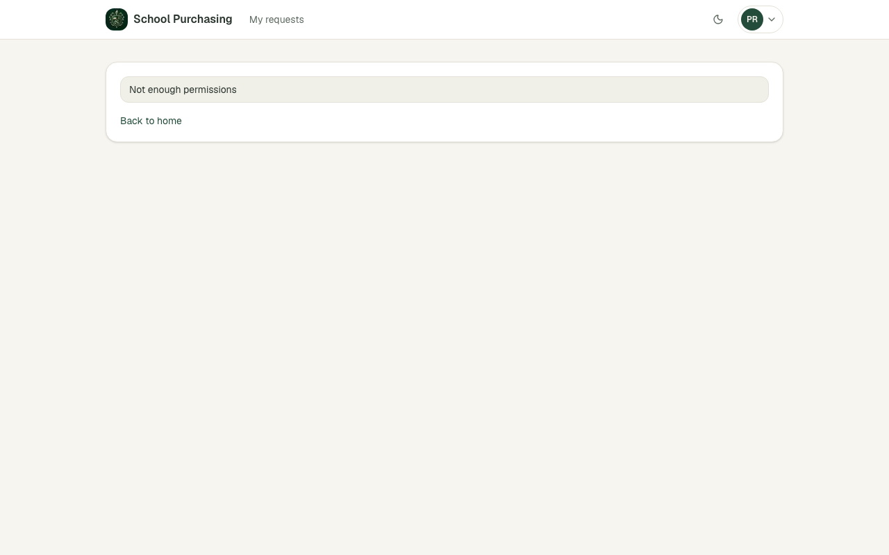
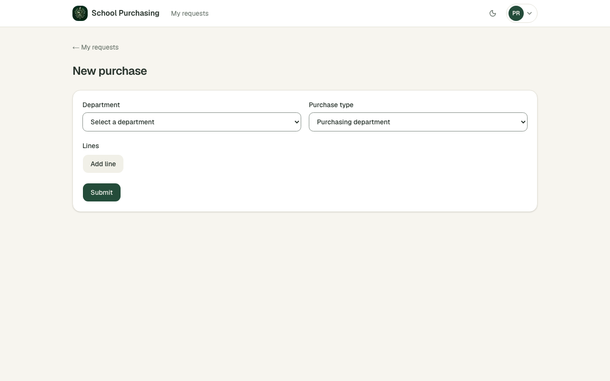
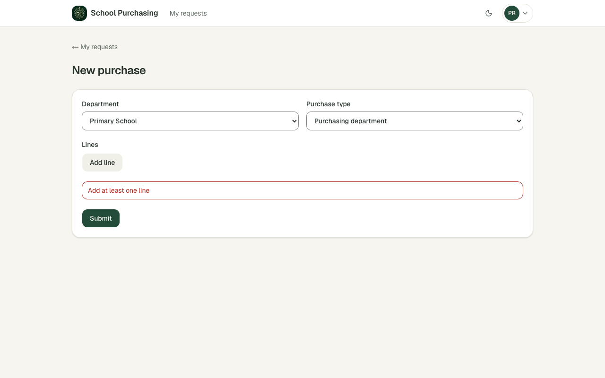

# Звіт UAT — 03.11.2026

- **Застосунок:** https://school-purchasing-lemon.vercel.app (/api/health: коміт `56fad31`)
- **Код тестів:** `task/uat` @ `420568d` + незакомічені зміни
- **Прогін:** 03.11.2026, 16:45 (Київ), Playwright 20.9 с; AC: 3 — PASS 3, FAIL 0, NEEDS-HUMAN 0
- **Рецензент:** `claude-haiku-5-5`; суперечки → `claude-sonnet-5-5`. Разом за розбір: $0.2884 (ціни API; за підпискою — у межах ліміту плану)
- **Прибирання:** синтетичних uat-*@example.test видалено 0, лишилось 0, їхніх рядків, що лишились: 0
- **Відео й траси:** не в git — `test-results/` локально або артефакт CI; трасу відкриває `npx playwright show-trace <trace.zip>`

| AC | Перевірки | Агент | Підсумок | Чому | Playwright | Розбір |
|---|---|---|---|---|---|---|
| AC-APR-04 | пройшли | Haiku: PASS | **PASS** | R6: перевірки, агент і цитати збігаються | 4.1 с | $0.0948, 7.4 с |
| AC-FRM-03 | пройшли | Haiku: PASS | **PASS** | R6: перевірки, агент і цитати збігаються | 4.0 с | $0.0970, 7.4 с |
| AC-FRM-06 | пройшли | Haiku: PASS | **PASS** | R6: перевірки, агент і цитати збігаються | 3.8 с | $0.0966, 7.4 с |

## AC-APR-04 — PASS

**Тест:** AC-APR-04: працівник 1 з роллю requester відкриває список для рішення за прямим посиланням — «Not enough permissions», жодної заявки

**Критерій** (requirements/48-skhvaliuvach-vyrishuie-lyshe.md):

> AC-APR-04: Дано працівник 1 з роллю `requester` увійшов. Коли він відкриває список для рішення за прямим посиланням. Тоді він бачить повідомлення «Недостатньо прав», жодної заявки йому не показано, і статуси заявок не змінилися.

**Кроки:** ✔ Дано: працівник 1 з роллю `requester` увійшов → ✔ Коли: він відкриває список для рішення за прямим посиланням → ✔ Тоді: він бачить повідомлення «Недостатньо прав», жодної заявки йому не показано, і статуси заявок не змінилися

**Агент (claude-haiku-5-5, PASS):** На кадрі /approvals видно картку з написом «Not enough permissions» і посиланням «Back to home», а заявок у списку немає. Текст збігається з англійським формулюванням PM посимвольно. Дві частини «Тоді» про відсутність заявок і незмінені статуси не видно з кадру, тому їх не оцінено.

**Цитати агента, звірені зі сторінкою (aria):**
- «Not enough permissions» — є на сторінці

**Правило:** R6: перевірки, агент і цитати збігаються

**Відео:** `test-results/artifacts/purchases-AC-APR-04-праців-c4974--permissions»-жодної-заявки-chromium/video.webm` · **траса:** `test-results/artifacts/purchases-AC-APR-04-праців-c4974--permissions»-жодної-заявки-chromium/trace.zip` (не в git)

**Рішення PM:** ☐ приймаю · ☐ відхилення від вимог (issue «Відхилення від вимог: AC-APR-04 — …») · @login: ____

## AC-FRM-03 — PASS

**Тест:** AC-FRM-03: без ролі admin і без дозволу «Self-purchase» у виборі типу лише «Purchasing department»

**Критерій** (requirements/47-pratsivnyk-podaie-zakupivliu.md):

> AC-FRM-03: Дано працівник 1 без ролі `admin` і без дозволу «Самостійна закупівля». Коли він відкриває форму закупівлі й розкриває вибір типу закупівлі. Тоді в списку лише «Відділ закупівель», а типу «Самостійна закупівля» немає.

**Кроки:** ✔ Дано: працівник 1 без ролі `admin` і без дозволу «Самостійна закупівля» → ✔ Коли: він відкриває форму закупівлі й розкриває вибір типу закупівлі → ✔ Тоді: в списку лише «Відділ закупівель», а типу «Самостійна закупівля» немає

**Агент (claude-haiku-5-5, PASS):** На кадрі /purchases/new видно поле «Purchase type», у якому вибрано «Purchasing department». Нативний список не розкритий, тож відсутність «Self-purchase» з кадру не підтверджується і оцінена як не з кадрів.

**Цитати агента, звірені зі сторінкою (aria):**
- «Purchase type» — є на сторінці
- «Purchasing department» — є на сторінці

**Правило:** R6: перевірки, агент і цитати збігаються

**Відео:** `test-results/artifacts/purchases-AC-FRM-03-без-ро-cb5b7-ише-«Purchasing-department»-chromium/video.webm` · **траса:** `test-results/artifacts/purchases-AC-FRM-03-без-ро-cb5b7-ише-«Purchasing-department»-chromium/trace.zip` (не в git)

**Рішення PM:** ☐ приймаю · ☐ відхилення від вимог (issue «Відхилення від вимог: AC-FRM-03 — …») · @login: ____

## AC-FRM-06 — PASS

**Тест:** AC-FRM-06: закупівля без жодного рядка не подається — «Add at least one line», відділ і тип лишаються у формі

**Критерій** (requirements/47-pratsivnyk-podaie-zakupivliu.md):

> AC-FRM-06: Дано працівник 1 обрав відділ «Початкова школа» й тип «Відділ закупівель», але не додав жодного рядка. Коли він намагається подати закупівлю. Тоді він бачить повідомлення «Додайте хоча б один рядок», обрані відділ і тип лишаються у формі, а закупівлю не подано.

**Кроки:** ✔ Дано: працівник 1 обрав відділ «Початкова школа» й тип «Відділ закупівель», але не додав жодного рядка → ✔ Коли: він намагається подати закупівлю → ✔ Тоді: він бачить повідомлення «Додайте хоча б один рядок», обрані відділ і тип лишаються у формі, а закупівлю не подано

**Агент (claude-haiku-5-5, PASS):** На кадрі frame-then-1.png сторінка /purchases/new показує червоне повідомлення «Add at least one line», у полі Department обрано «Primary School», у полі Purchase type — «Purchasing department». Текст повідомлення англійський, але ac.md прямо називає його відповідником PM-формулювання «Додайте хоча б один рядок», тож невідповідності немає. Факт неподання закупівлі на кадрі не оцінювався (це не з кадрів).

**Цитати агента, звірені зі сторінкою (aria):**
- «Add at least one line» — є на сторінці
- «Primary School» — є на сторінці
- «Purchasing department» — є на сторінці

**Правило:** R6: перевірки, агент і цитати збігаються

**Відео:** `test-results/artifacts/purchases-AC-FRM-06-закупі-ff45d-діл-і-тип-лишаються-у-формі-chromium/video.webm` · **траса:** `test-results/artifacts/purchases-AC-FRM-06-закупі-ff45d-діл-і-тип-лишаються-у-формі-chromium/trace.zip` (не в git)

**Рішення PM:** ☐ приймаю · ☐ відхилення від вимог (issue «Відхилення від вимог: AC-FRM-06 — …») · @login: ____

## Як читати підсумок

- **PASS** — автоматичні перевірки пройшли, агент-рецензент погодився з кадром, а кожну його цитату знайдено на сторінці.
- **FAIL** — впала автоматична перевірка. Агент цього не перекриває: невидимі вади (буфер обміну, база) він на кадрі не побачить.
- **NEEDS-HUMAN** — перевірки зелені, але агент не погодився або його цитати немає на сторінці. Часто це слабкий тест або розбіжність між текстом AC і тестом — питання до PM, а не обов'язково вада продукту.

Правила: R1: перевірка впала — FAIL завжди, агент не перекриває; R2: немає вердикту агента або кадру; R3: перевірки пройшли, агент не погоджується — вирішує людина; R4: цитати агента немає на сторінці (aria) — не підтверджено; R5: помилка сторінки або 5xx під час сценарію; R6: перевірки, агент і цитати збігаються.
