# Звіт UAT — 12.11.2026

- **Застосунок:** https://school-purchasing-lemon.vercel.app (/api/health: коміт `a5c725e`)
- **Код тестів:** `task/uat-ws9` @ `e55d6ae` + незакомічені зміни
- **Прогін:** 12.11.2026, 10:47 (Київ), Playwright 321.1 с; AC: 9 — PASS 8, FAIL 0, NEEDS-HUMAN 1
- **Рецензент:** `claude-haiku-5-5`; суперечки → `claude-sonnet-5-5`. Разом за розбір: $1.3197 (ціни API; за підпискою — у межах ліміту плану)
- **Прибирання:** синтетичних uat-*@example.test видалено 9, лишилось 0, їхніх рядків, що лишились: 0
- **Відео й траси:** не в git — `test-results/` локально або артефакт CI; трасу відкриває `npx playwright show-trace <trace.zip>`

| AC | Перевірки | Агент | Підсумок | Чому | Playwright | Розбір |
|---|---|---|---|---|---|---|
| AC-DEC-01 | пройшли | Haiku: NEEDS-HUMAN, Sonnet: PASS | **PASS** | R6: перевірки, агент і цитати збігаються | 49.9 с | $0.2247, 25.1 с |
| AC-DEC-04 | пройшли | Haiku: PASS | **PASS** | R6: перевірки, агент і цитати збігаються | 25.7 с | $0.1281, 12.5 с |
| AC-DEC-06 | пройшли | Haiku: NEEDS-HUMAN, Sonnet: PASS | **PASS** | R6: перевірки, агент і цитати збігаються | 35.1 с | $0.2006, 17.7 с |
| AC-DEC-07 | пройшли | Haiku: PASS | **PASS** | R6: перевірки, агент і цитати збігаються | 17.2 с | $0.1164, 8.8 с |
| AC-HIST-01 | пройшли | Haiku: PASS | **PASS** | R6: перевірки, агент і цитати збігаються | 25.6 с | $0.0963, 7.2 с |
| AC-HIST-02 | пройшли | Haiku: PASS | **PASS** | R6: перевірки, агент і цитати збігаються | 23.1 с | $0.0935, 6.1 с |
| AC-HIST-06 | пройшли | Haiku: NEEDS-HUMAN, Sonnet: NEEDS-HUMAN | **NEEDS-HUMAN** | R3: перевірки пройшли, агент не погоджується — вирішує людина | 20.0 с | $0.2135, 22.9 с |
| AC-HIST-10 | пройшли | Haiku: PASS | **PASS** | R6: перевірки, агент і цитати збігаються | 31.5 с | $0.1002, 7.6 с |
| AC-LANG-09 | пройшли | Haiku: PASS | **PASS** | R6: перевірки, агент і цитати збігаються | 58.7 с | $0.1464, 11.9 с |

## AC-DEC-01 — PASS

**Тест:** AC-DEC-01: Марія відхиляє рядок 2 і схвалює заявку — «Partially approved», автор бачить рядок 2 «Rejected», рядки 1 і 3 «Approved»

**Критерій** (requirements/63-skhvaliuvach-chastkovo-skhvaliuie.md):

> AC-DEC-01: Дано заявка відділу «Початкова школа» з трьома рядками зі статусом «Очікує схвалення», автор — не Марія, Марія схвалює цей відділ. Коли Марія відхиляє рядок 2 і схвалює заявку. Тоді статус заявки «Частково схвалено», автор бачить рядок 2 зі статусом «Відхилено», а рядки 1 і 3 — зі статусом «Схвалено».

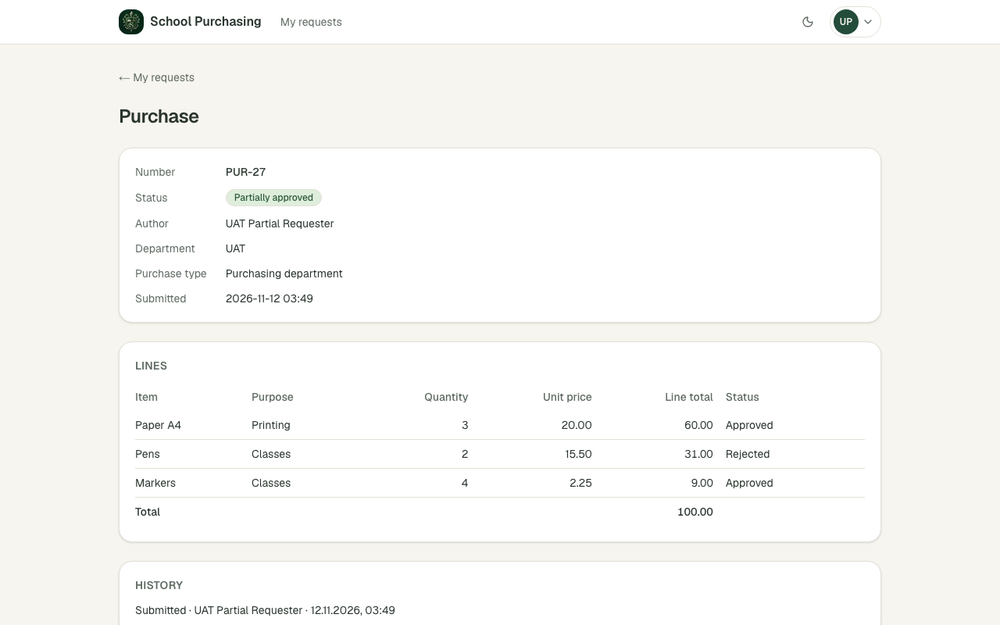

**Кроки:** ✔ Дано: заявка відділу «UAT» (замість «Початкової школи») з трьома рядками «Очікує схвалення», автор — не Марія, Марія схвалює цей відділ → ✔ Коли: Марія відхиляє рядок 2 і схвалює заявку → ✔ Тоді: статус заявки «Частково схвалено», автор бачить рядок 2 зі статусом «Відхилено», а рядки 1 і 3 — «Схвалено»

**Агент (claude-sonnet-5-5, PASS):** На кадрі сторінка заявки PUR-27 зі статусом «Partially approved». Рядки: Paper A4 — Approved, Pens — Rejected, Markers — Approved. Відділ у Дано — «UAT» замість «Початкової школи», це зазначено в journey.md і на видимі частини «Тоді» не впливає.

Haiku сказав NEEDS-HUMAN, тож розбір повторив Sonnet; рішення агента — за Sonnet.

**Цитати агента, звірені зі сторінкою (aria):**
- «Status» — є на сторінці
- «Partially approved» — є на сторінці
- «Author» — є на сторінці
- «UAT Partial Requester» — є на сторінці
- «Paper A4» — є на сторінці
- «Approved» — є на сторінці
- «Pens» — є на сторінці
- «Rejected» — є на сторінці
- «Markers» — є на сторінці
- «Approved» — є на сторінці

**Правило:** R6: перевірки, агент і цитати збігаються

**Відео:** `test-results/artifacts/partial-approval-AC-DEC-01-e44c1-ted»-рядки-1-і-3-«Approved»-chromium/video.webm` · **траса:** `test-results/artifacts/partial-approval-AC-DEC-01-e44c1-ted»-рядки-1-і-3-«Approved»-chromium/trace.zip` (не в git)

**Рішення PM:** ☐ приймаю · ☐ відхилення від вимог (issue «Відхилення від вимог: AC-DEC-01 — …») · @login: ____

## AC-DEC-04 — PASS

**Тест:** AC-DEC-04: Марія повертає заявку з причиною «Уточніть кількість» — статус «Returned for revision»

**Критерій** (requirements/63-skhvaliuvach-chastkovo-skhvaliuie.md):

> AC-DEC-04: Дано заявка відділу «Початкова школа» зі статусом «Очікує схвалення», автор — не Марія, Марія схвалює цей відділ. Коли Марія повертає заявку на доопрацювання з причиною «Уточніть кількість». Тоді статус заявки «Повернено на доопрацювання».

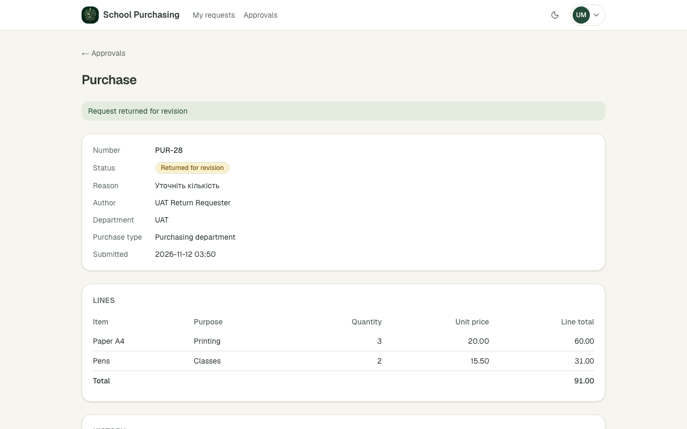
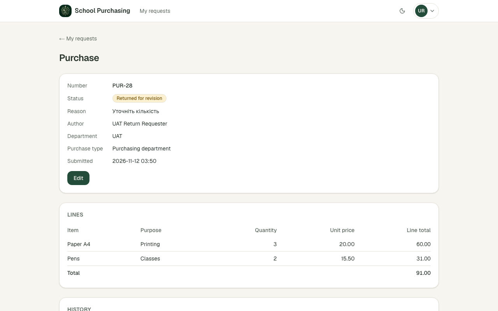

**Кроки:** ✔ Дано: заявка відділу «UAT» зі статусом «Очікує схвалення», автор — не Марія, Марія схвалює цей відділ → ✔ Коли: Марія повертає заявку на доопрацювання з причиною «Уточніть кількість» → ✔ Тоді: статус заявки «Повернено на доопрацювання» → ✔ Коли: автор відкриває свою заявку → ✔ Тоді: статус заявки «Повернено на доопрацювання»

**Агент (claude-haiku-5-5, PASS):** На обох кадрах у блоці заявки PUR-28 (відділ UAT) статус показано як «Returned for revision», а причина — «Уточніть кількість»; на кадрі 1 видно банер «Request returned for revision». Текст статусу на екрані англійський, тоді як у тексті критерію — «Повернено на доопрацювання»; перевірка виконана за переліком видимих частин з ac.md, який очікує саме «Returned for revision», тож це не вада, але варто, щоб PM підтвердив мову інтерфейсу.

**Цитати агента, звірені зі сторінкою (aria):**
- «Returned for revision» — є на сторінці
- «Returned for revision» — є на сторінці
- «Уточніть кількість» — є на сторінці

**Правило:** R6: перевірки, агент і цитати збігаються

**Відео:** `test-results/artifacts/return-for-revision-AC-DEC-3dfa6-тус-«Returned-for-revision»-chromium/video.webm` · **траса:** `test-results/artifacts/return-for-revision-AC-DEC-3dfa6-тус-«Returned-for-revision»-chromium/trace.zip` (не в git)

**Рішення PM:** ☐ приймаю · ☐ відхилення від вимог (issue «Відхилення від вимог: AC-DEC-04 — …») · @login: ____

## AC-DEC-06 — PASS

**Тест:** AC-DEC-06: Марія повертає заявку на доопрацювання без причини — «Provide a reason», статус лишається «Awaiting approval»

**Критерій** (requirements/63-skhvaliuvach-chastkovo-skhvaliuie.md):

> AC-DEC-06: Дано заявка відділу «Початкова школа» зі статусом «Очікує схвалення», Марія схвалює цей відділ. Коли Марія повертає заявку на доопрацювання без причини. Тоді вона бачить повідомлення «Вкажіть причину», а статус заявки лишається «Очікує схвалення».

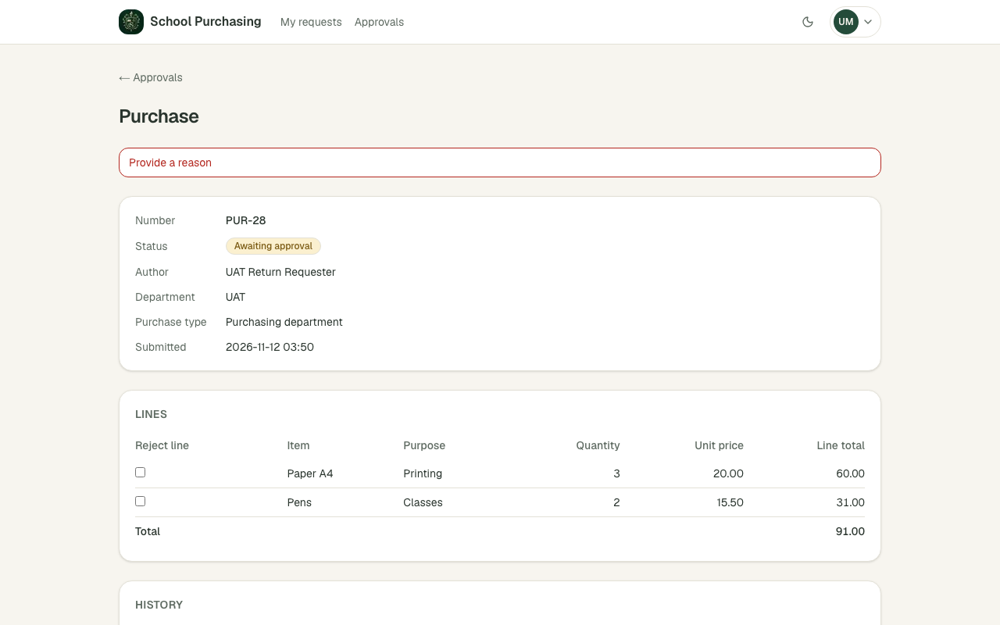

**Кроки:** ✔ Дано: заявка відділу «UAT» (замість «Початкової школи») зі статусом «Очікує схвалення», Марія схвалює цей відділ → ✔ Коли: Марія повертає заявку на доопрацювання без причини → ✔ Тоді: вона бачить повідомлення «Вкажіть причину», а статус заявки лишається «Очікує схвалення»

**Агент (claude-sonnet-5-5, PASS):** На кадрі сторінки закупівлі PUR-28 вгорі червоне повідомлення «Provide a reason», у картці статус «Awaiting approval». Обидві видимі частини «Тоді» збігаються з критерієм.

Haiku сказав NEEDS-HUMAN, тож розбір повторив Sonnet; рішення агента — за Sonnet.

**Агент бачить вади:**
- Відділ у Дано — «UAT» замість «Початкова школа» (зазначено в journey.md); на кадрі відділ теж «UAT».

**Цитати агента, звірені зі сторінкою (aria):**
- «Provide a reason» — є на сторінці
- «Awaiting approval» — є на сторінці

**Правило:** R6: перевірки, агент і цитати збігаються

**Відео:** `test-results/artifacts/return-for-revision-AC-DEC-68c27-шається-«Awaiting-approval»-chromium/video.webm` · **траса:** `test-results/artifacts/return-for-revision-AC-DEC-68c27-шається-«Awaiting-approval»-chromium/trace.zip` (не в git)

**Рішення PM:** ☐ приймаю · ☐ відхилення від вимог (issue «Відхилення від вимог: AC-DEC-06 — …») · @login: ____

## AC-DEC-07 — PASS

**Тест:** AC-DEC-07: автор виправив рядок 1 і подає заявку знову — статус «Awaiting approval», відділ той самий

**Критерій** (requirements/63-skhvaliuvach-chastkovo-skhvaliuie.md):

> AC-DEC-07: Дано заявка зі статусом «Повернено на доопрацювання», автор виправив рядок 1. Коли автор подає заявку знову. Тоді статус заявки «Очікує схвалення», відділ той самий.

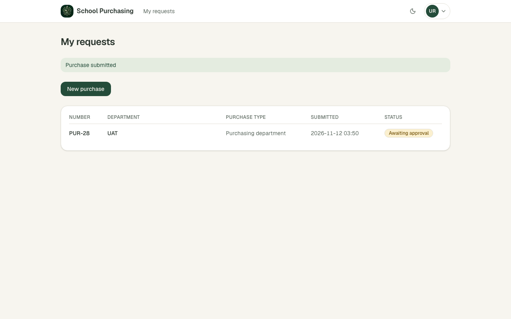
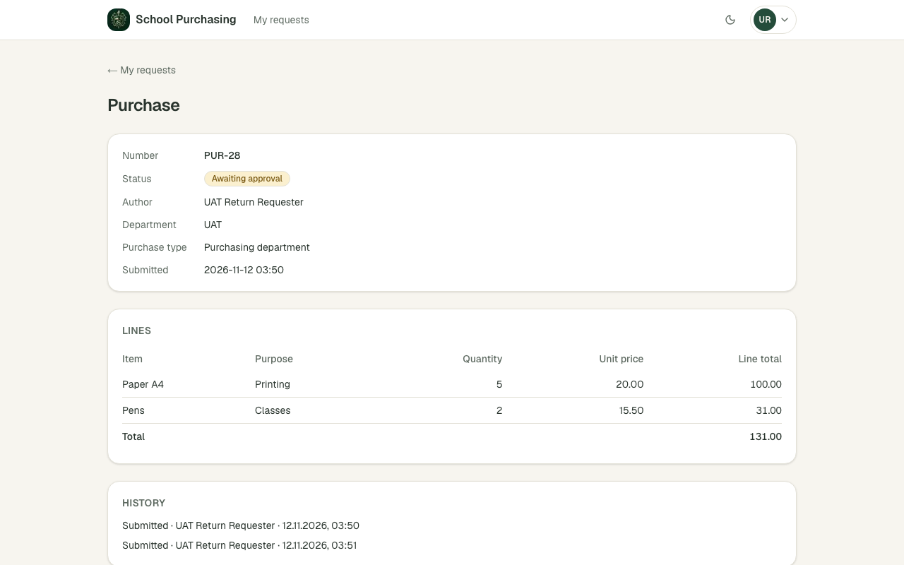

**Кроки:** ✔ Дано: заявка зі статусом «Повернено на доопрацювання», автор виправив рядок 1 → ✔ Коли: автор подає заявку знову → ✔ Тоді: статус заявки «Очікує схвалення», відділ той самий → ✔ Коли: автор відкриває заявку → ✔ Тоді: статус заявки «Очікує схвалення», відділ той самий

**Агент (claude-haiku-5-5, PASS):** На кадрі 1 видно зелене повідомлення «Purchase submitted» і рядок заявки PUR-28 зі відділом UAT та статусом «Awaiting approval». На кадрі 2 сторінка заявки PUR-28 показує статус «Awaiting approval» і відділ UAT. Обидві видимі частини «Тоді» підтверджено.

**Цитати агента, звірені зі сторінкою (aria):**
- «Purchase submitted» — є на сторінці
- «PUR-28» — є на сторінці
- «UAT» — є на сторінці
- «Awaiting approval» — є на сторінці
- «Awaiting approval» — є на сторінці
- «UAT» — є на сторінці

**Правило:** R6: перевірки, агент і цитати збігаються

**Відео:** `test-results/artifacts/return-for-revision-AC-DEC-e66f9--approval»-відділ-той-самий-chromium/video.webm` · **траса:** `test-results/artifacts/return-for-revision-AC-DEC-e66f9--approval»-відділ-той-самий-chromium/trace.zip` (не в git)

**Рішення PM:** ☐ приймаю · ☐ відхилення від вимог (issue «Відхилення від вимог: AC-DEC-07 — …») · @login: ____

## AC-HIST-01 — PASS

**Тест:** AC-HIST-01: працівник 1 подає першу закупівлю, а потім другу — у «My requests» вони мають номери підряд

**Критерій** (requirements/64-zaiavka-maie-nomer-sumy-riadkiv.md):

> AC-HIST-01: Дано в системі ще немає жодної закупівлі. Коли працівник 1 подає першу закупівлю, а потім другу. Тоді в списку «Мої заявки» вони мають номери «PUR-1» і «PUR-2».

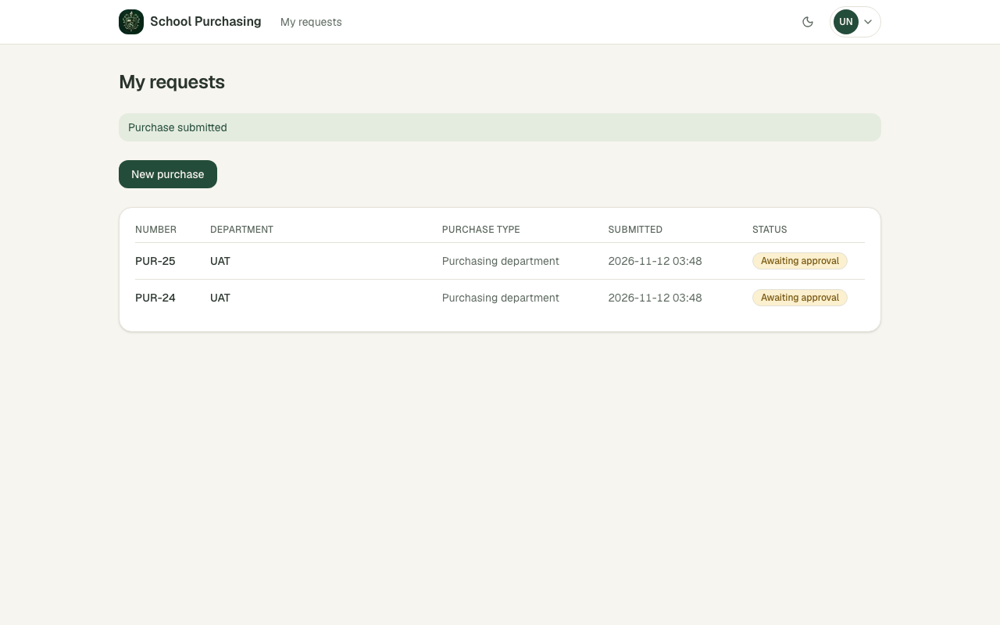

**Кроки:** ✔ Дано: в системі ще немає жодної закупівлі — на проді заявки вже є, тож новий заявник без жодної заявки (відповідь PM #73) → ✔ Коли: працівник 1 подає першу закупівлю, а потім другу → ✔ Тоді: в списку «Мої заявки» вони мають номери «PUR-1» і «PUR-2»

**Агент (claude-haiku-5-5, PASS):** На кадрі в таблиці «My requests» два рядки з номерами PUR-25 (зверху) і PUR-24 (нижче), тобто пара підряд із різницею в одиницю. Порядок «новіша перша» відповідає очікуванню з розділу «Не з кадрів», яке я не оцінював.

**Цитати агента, звірені зі сторінкою (aria):**
- «PUR-25» — є на сторінці
- «PUR-24» — є на сторінці

**Правило:** R6: перевірки, агент і цитати збігаються

**Відео:** `test-results/artifacts/numbers-AC-HIST-01-працівн-1c8c5-s»-вони-мають-номери-підряд-chromium/video.webm` · **траса:** `test-results/artifacts/numbers-AC-HIST-01-працівн-1c8c5-s»-вони-мають-номери-підряд-chromium/trace.zip` (не в git)

**Рішення PM:** ☐ приймаю · ☐ відхилення від вимог (issue «Відхилення від вимог: AC-HIST-01 — …») · @login: ____

## AC-HIST-02 — PASS

**Тест:** AC-HIST-02: автор відкриває заявку з рядками 3 × 20.00 і 2 × 15.50 — суми рядків 60.00 і 31.00, сума заявки 91.00

**Критерій** (requirements/64-zaiavka-maie-nomer-sumy-riadkiv.md):

> AC-HIST-02: Дано закупівля з двома рядками: кількість 3 за ціною 20.00 і кількість 2 за ціною 15.50. Коли автор відкриває заявку. Тоді суми рядків 60.00 і 31.00, а сума заявки 91.00.

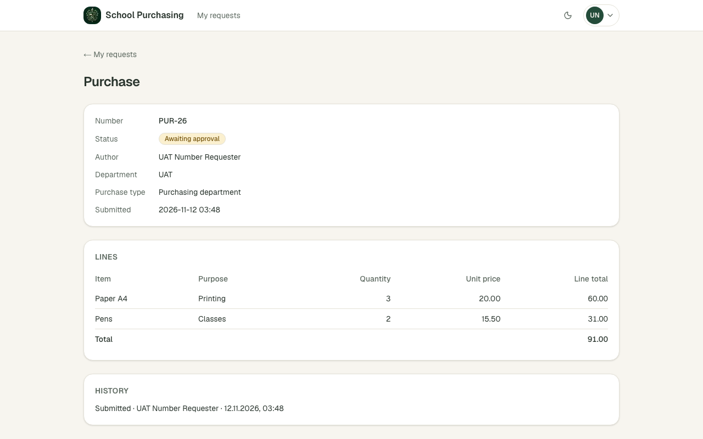

**Кроки:** ✔ Дано: закупівля з двома рядками: кількість 3 за ціною 20.00 і кількість 2 за ціною 15.50 → ✔ Коли: автор відкриває заявку → ✔ Тоді: суми рядків 60.00 і 31.00, а сума заявки 91.00

**Агент (claude-haiku-5-5, PASS):** На кадрі видно таблицю «LINES»: Paper A4 (3 × 20.00) має Line total 60.00, Pens (2 × 15.50) має Line total 31.00. Рядок «Total» під ними показує 91.00, що відповідає критерію.

**Цитати агента, звірені зі сторінкою (aria):**
- «60.00» — є на сторінці
- «31.00» — є на сторінці
- «91.00» — є на сторінці

**Правило:** R6: перевірки, агент і цитати збігаються

**Відео:** `test-results/artifacts/numbers-AC-HIST-02-автор-в-b29c2-0-і-31-00-сума-заявки-91-00-chromium/video.webm` · **траса:** `test-results/artifacts/numbers-AC-HIST-02-автор-в-b29c2-0-і-31-00-сума-заявки-91-00-chromium/trace.zip` (не в git)

**Рішення PM:** ☐ приймаю · ☐ відхилення від вимог (issue «Відхилення від вимог: AC-HIST-02 — …») · @login: ____

## AC-HIST-06 — NEEDS-HUMAN

**Тест:** AC-HIST-06: працівник 1 подав закупівлю й відкриває історію цієї заявки — запис «Submitted» з його іменем, датою й часом

**Критерій** (requirements/64-zaiavka-maie-nomer-sumy-riadkiv.md):

> AC-HIST-06: Дано працівник 1 подав закупівлю у відділ «Початкова школа». Коли він відкриває історію цієї заявки. Тоді в історії є запис «Подано» з його іменем і датою та часом за часом `America/New_York`.

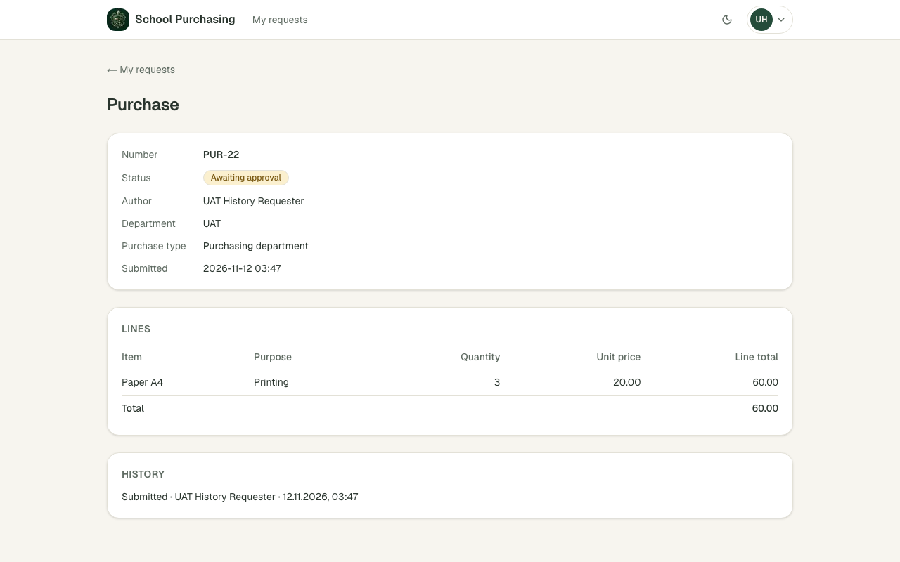

**Кроки:** ✔ Дано: працівник 1 подав закупівлю у відділ «UAT» (замість «Початкової школи») → ✔ Коли: він відкриває історію цієї заявки → ✔ Тоді: в історії є запис «Подано» з його іменем і датою та часом за часом `America/New_York`

**Агент (claude-sonnet-5-5, NEEDS-HUMAN):** У блоці історії видно рядок «Submitted · UAT History Requester · 12.11.2026, 03:47», що збігається з очікуваним текстом. Проте заявку подано у відділ «UAT», а не «Початкова школа», як вимагає «Дано», тож сценарій не відтворює критерій дослівно — потрібне рішення людини.

Haiku сказав NEEDS-HUMAN, тож розбір повторив Sonnet; рішення агента — за Sonnet.

**Агент бачить вади:**
- Передумова «Дано» не відповідає критерію: на кадрі поле Department має значення «UAT», а не «Початкова школа».
- Заголовок блоку на кадрі відображається як «HISTORY» (великими літерами), а в критерії — «History»; імовірно це стилізація, але потребує підтвердження.

**Цитати агента, звірені зі сторінкою (aria):**
- «Submitted · UAT History Requester · 12.11.2026, 03:47» — є на сторінці

**Правило:** R3: перевірки пройшли, агент не погоджується — вирішує людина

**Відео:** `test-results/artifacts/history-AC-HIST-06-працівн-9cbc5-з-його-іменем-датою-й-часом-chromium/video.webm` · **траса:** `test-results/artifacts/history-AC-HIST-06-працівн-9cbc5-з-його-іменем-датою-й-часом-chromium/trace.zip` (не в git)

**Рішення PM:** ☐ приймаю · ☐ відхилення від вимог (issue «Відхилення від вимог: AC-HIST-06 — …») · @login: ____

## AC-HIST-10 — PASS

**Тест:** AC-HIST-10: Петро схвалює лише інший відділ і відкриває історію заявки за прямим посиланням — «Not enough permissions», історії немає, статус той самий

**Критерій** (requirements/64-zaiavka-maie-nomer-sumy-riadkiv.md):

> AC-HIST-10: Дано Петро схвалює лише відділ «Офіс», заявка відділу «Початкова школа» з історією рішень. Коли Петро відкриває історію цієї заявки за прямим посиланням. Тоді він бачить повідомлення «Недостатньо прав», історії не показано, а статус заявки не змінився.

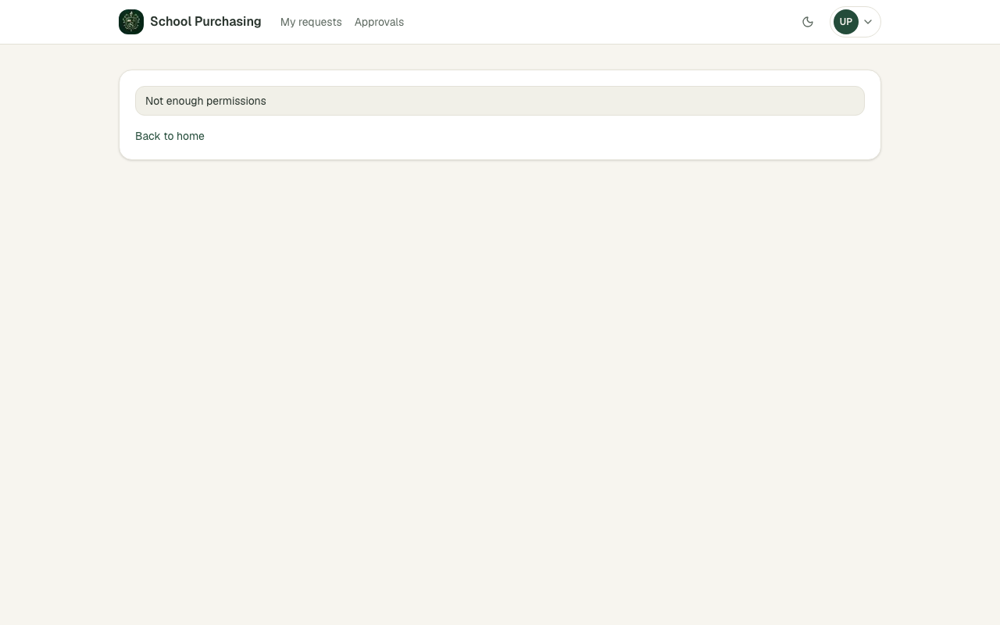

**Кроки:** ✔ Дано: Петро схвалює лише відділ «UAT-2» (замість «Офісу»), заявка відділу «UAT» (замість «Початкової школи») з історією → ✔ Коли: Петро відкриває історію цієї заявки за прямим посиланням → ✔ Тоді: він бачить повідомлення «Недостатньо прав»

**Агент (claude-haiku-5-5, PASS):** На кадрі frame-then-1.png видно сторінку з одним повідомленням «Not enough permissions» і посиланням «Back to to home» (фактично «Back to home»), без будь-якого блоку історії чи записів заявки. Видима частина «Тоді» відповідає критерію дослівно. Частини про відсутність історії та незмінний статус не з кадрів, тому не оцінювалися.

**Цитати агента, звірені зі сторінкою (aria):**
- «Not enough permissions» — є на сторінці

**Правило:** R6: перевірки, агент і цитати збігаються

**Відео:** `test-results/artifacts/history-AC-HIST-10-Петро-с-ae774-орії-немає-статус-той-самий-chromium/video.webm` · **траса:** `test-results/artifacts/history-AC-HIST-10-Петро-с-ae774-орії-немає-статус-той-самий-chromium/trace.zip` (не в git)

**Рішення PM:** ☐ приймаю · ☐ відхилення від вимог (issue «Відхилення від вимог: AC-HIST-10 — …») · @login: ____

## AC-LANG-09 — PASS

**Тест:** AC-LANG-09: заявки «Частково схвалено» і «Повернено на доопрацювання» — у «My requests» і на сторінці заявки текст «Partially approved» і «Returned for revision»

**Критерій** (requirements/49-interfeis-zastosunku-anhliiskoiu.md):

> AC-LANG-09: Дано заявка зі статусом «Частково схвалено» чи «Повернено на доопрацювання». Коли її показано у списку, на сторінці заявки або в історії. Тоді статус підписано текстом «Partially approved» чи «Returned for revision» відповідно, а не лише кольором.

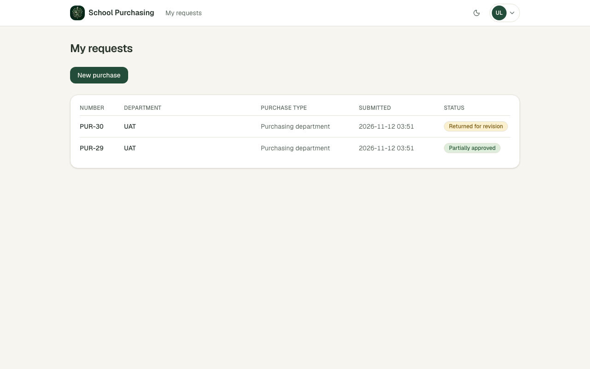
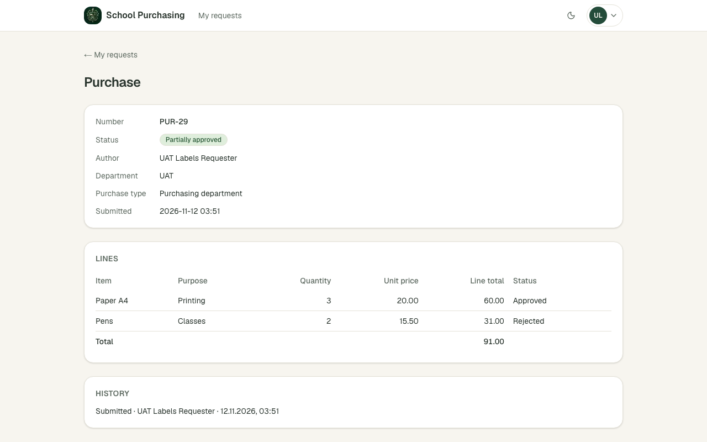
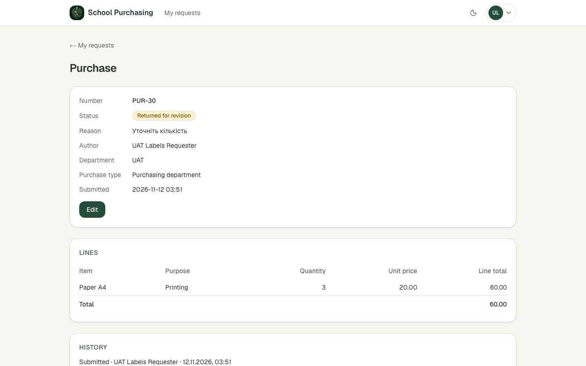

**Кроки:** ✔ Дано: заявка зі статусом «Частково схвалено» і заявка зі статусом «Повернено на доопрацювання» (відділ «UAT», рішення Марії) → ✔ Коли: автор відкриває список «My requests» → ✔ Тоді: статус підписано текстом «Partially approved» чи «Returned for revision» відповідно, а не лише кольором → ✔ Коли: автор відкриває сторінку першої заявки → ✔ Тоді: статус підписано текстом «Partially approved» чи «Returned for revision» відповідно, а не лише кольором → ✔ Коли: автор відкриває сторінку другої заявки → ✔ Тоді: статус підписано текстом «Partially approved» чи «Returned for revision» відповідно, а не лише кольором

**Агент (claude-haiku-5-5, PASS):** На кадрі списку порядок рядків зворотний до порядку в критерії: перший рядок — PUR-30 з «Returned for revision», другий — PUR-29 з «Partially approved». Я зіставив частини за номером заявки (перша заявка — PUR-29, друга — PUR-30), бо сторінки PUR-29 і PUR-30 на кадрах 2 і 3 узгоджені з цим зіставленням; тому оцінив як met. На сторінках заявок статус підписано текстом поруч із кольоровим бейджем, як вимагає критерій. Якщо PM мав на увазі саме позицію рядків, а не ідентичність заявки, варто перевірити людині.

**Цитати агента, звірені зі сторінкою (aria):**
- «Partially approved» — є на сторінці
- «Returned for revision» — є на сторінці
- «Partially approved» — є на сторінці
- «Returned for revision» — є на сторінці

**Правило:** R6: перевірки, агент і цитати збігаються

**Відео:** `test-results/artifacts/status-labels-AC-LANG-09-з-f73fa-»-і-«Returned-for-revision»-chromium/video.webm` · **траса:** `test-results/artifacts/status-labels-AC-LANG-09-з-f73fa-»-і-«Returned-for-revision»-chromium/trace.zip` (не в git)

**Рішення PM:** ☐ приймаю · ☐ відхилення від вимог (issue «Відхилення від вимог: AC-LANG-09 — …») · @login: ____

## Як читати підсумок

- **PASS** — автоматичні перевірки пройшли, агент-рецензент погодився з кадром, а кожну його цитату знайдено на сторінці.
- **FAIL** — впала автоматична перевірка. Агент цього не перекриває: невидимі вади (буфер обміну, база) він на кадрі не побачить.
- **NEEDS-HUMAN** — перевірки зелені, але агент не погодився або його цитати немає на сторінці. Часто це слабкий тест або розбіжність між текстом AC і тестом — питання до PM, а не обов'язково вада продукту.

Правила: R1: перевірка впала — FAIL завжди, агент не перекриває; R2: немає вердикту агента або кадру; R3: перевірки пройшли, агент не погоджується — вирішує людина; R4: цитати агента немає на сторінці (aria) — не підтверджено; R5: помилка сторінки або 5xx під час сценарію; R6: перевірки, агент і цитати збігаються.
