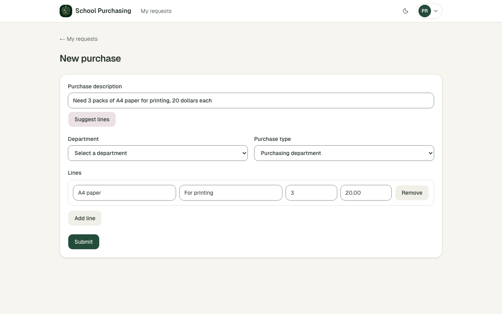
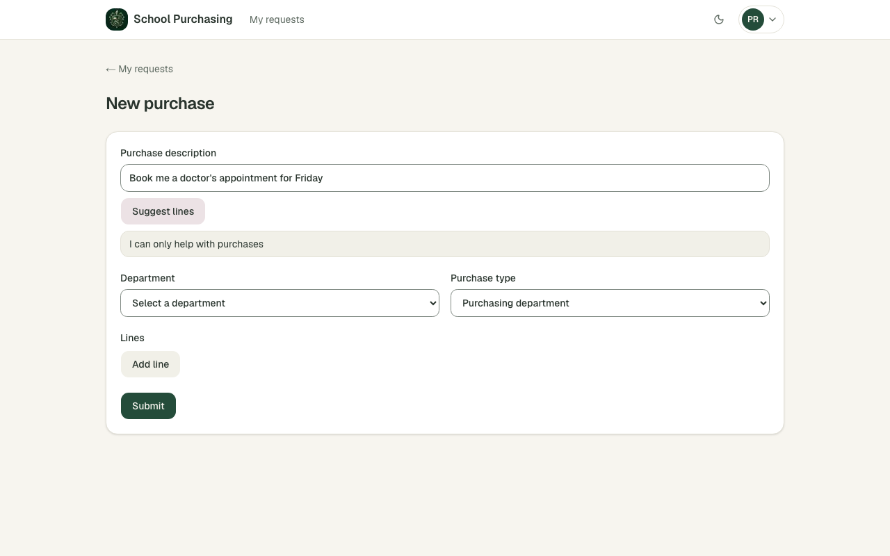

# Звіт UAT — 23.11.2026

- **Застосунок:** https://school-purchasing-lemon.vercel.app (/api/health: коміт `07c56e6`)
- **Код тестів:** `uat/ai-english-2026-11-23` @ `07c56e6`
- **Прогін:** 23.11.2026, 13:24 (Київ), Playwright 25.9 с; AC: 2 — PASS 2, FAIL 0, NEEDS-HUMAN 0
- **Рецензент:** `claude-haiku-5-5`; суперечки → `claude-sonnet-5-5`. Разом за розбір: $0.0072 (ціни API; за підпискою — у межах ліміту плану)
- **Прибирання:** синтетичних uat-*@example.test видалено 0, лишилось 0, їхніх рядків, що лишились: 0
- **Відео й траси:** не в git — `test-results/` локально або артефакт CI; трасу відкриває `npx playwright show-trace <trace.zip>`

| AC | Перевірки | Агент | Підсумок | Чому | Playwright | Розбір |
|---|---|---|---|---|---|---|
| AC-AI-01 | пройшли | Haiku: PASS | **PASS** | R6: перевірки, агент і цитати збігаються | 11.0 с | $0.0032, 9.9 с |
| AC-AI-02 | пройшли | Haiku: PASS | **PASS** | R6: перевірки, агент і цитати збігаються | 5.9 с | $0.0040, 7.7 с |

## AC-AI-01 — PASS

**Тест:** AC-AI-01: працівник 1 вставляє опис «Need 3 packs of A4 paper for printing, 20 dollars each» — рядок A4 paper / For printing / 3 / 20.00, закупівлю не подано

**Критерій** (requirements/71-ai-proponuie-riadky-zakupivli-za.md):

> AC-AI-01: Дано працівник 1 відкрив форму нової закупівлі. Коли він вставляє опис «Need 3 packs of A4 paper for printing, 20 dollars each» і натискає «Suggest lines». Тоді він бачить один рядок: назва «A4 paper», мета «For printing», кількість 3, ціна 20.00, а закупівлю ще не подано.

**Кроки:** ✔ Дано: працівник 1 відкрив форму нової закупівлі → ✔ Коли: він вставляє опис «Need 3 packs of A4 paper for printing, 20 dollars each» і натискає «Suggest lines» → ✔ Тоді: він бачить один рядок: назва «A4 paper», мета «For printing», кількість 3, ціна 20.00 → ✔ Тоді: закупівлю ще не подано

**Агент (claude-haiku-5-5, PASS):** На frame-then-1 видно сторінку «New purchase» з одним рядком закупівлі: «A4 paper», «For printing», 3, 20.00. На frame-then-2 форма залишається відкритою, кнопка «Submit» на місці, повідомлення про подачу не видно. Поля в рядку не мають підписів на кадрі, тому перевірка йдеться за їхніми значеннями.

**Цитати агента, звірені зі сторінкою (aria):**
- «A4 paper» — є на сторінці
- «For printing» — є на сторінці
- «3» — є на сторінці
- «20.00» — є на сторінці
- «A4 paper» — є на сторінці
- «For printing» — є на сторінці
- «3» — є на сторінці
- «20.00» — є на сторінці
- «New purchase» — є на сторінці
- «Submit» — є на сторінці

**Правило:** R6: перевірки, агент і цитати збігаються

**Відео:** `test-results/artifacts/ai-suggest-AC-AI-01-праців-76f9b-3-20-00-закупівлю-не-подано-chromium/video-2.webm` · **траса:** `test-results/artifacts/ai-suggest-AC-AI-01-праців-76f9b-3-20-00-закупівлю-не-подано-chromium/trace.zip` (не в git)

**Рішення PM:** ☐ приймаю · ☐ відхилення від вимог (issue «Відхилення від вимог: AC-AI-01 — …») · @login: ____

## AC-AI-02 — PASS

**Тест:** AC-AI-02: працівник 1 вставляє опис «Book me a doctor's appointment for Friday» — «I can only help with purchases», рядків не додано

**Критерій** (requirements/71-ai-proponuie-riadky-zakupivli-za.md):

> AC-AI-02: Дано працівник 1 відкрив форму нової закупівлі. Коли він вставляє опис «Book me a doctor's appointment for Friday» і натискає «Suggest lines». Тоді він бачить повідомлення «I can only help with purchases», а рядків у формі не додано.

**Кроки:** ✔ Дано: працівник 1 відкрив форму нової закупівлі → ✔ Коли: він вставляє опис «Book me a doctor's appointment for Friday» і натискає «Suggest lines» → ✔ Тоді: він бачить повідомлення «I can only help with purchases» → ✔ Тоді: рядків у формі не додано

**Агент (claude-haiku-5-5, PASS):** На обох кадрах у полі опису введено «Book me a doctor's appointment for Friday», під кнопкою «Suggest lines» показано повідомлення «I can only help with purchases». У розділі «Lines» є лише кнопка «Add line», полів «Item», «Purpose», «Quantity», «Unit price» немає, тож рядків не додано. Кадри 1 і 2 збігаються.

**Цитати агента, звірені зі сторінкою (aria):**
- «I can only help with purchases» — є на сторінці
- «Lines» — є на сторінці
- «Add line» — є на сторінці

**Правило:** R6: перевірки, агент і цитати збігаються

**Відео:** `test-results/artifacts/ai-suggest-AC-AI-02-праців-66ed9-purchases»-рядків-не-додано-chromium/video.webm` · **траса:** `test-results/artifacts/ai-suggest-AC-AI-02-праців-66ed9-purchases»-рядків-не-додано-chromium/trace.zip` (не в git)

**Рішення PM:** ☐ приймаю · ☐ відхилення від вимог (issue «Відхилення від вимог: AC-AI-02 — …») · @login: ____

## Як читати підсумок

- **PASS** — автоматичні перевірки пройшли, агент-рецензент погодився з кадром, а кожну його цитату знайдено на сторінці.
- **FAIL** — впала автоматична перевірка. Агент цього не перекриває: невидимі вади (буфер обміну, база) він на кадрі не побачить.
- **NEEDS-HUMAN** — перевірки зелені, але агент не погодився або його цитати немає на сторінці. Часто це слабкий тест або розбіжність між текстом AC і тестом — питання до PM, а не обов'язково вада продукту.

Правила: R1: перевірка впала — FAIL завжди, агент не перекриває; R2: немає вердикту агента або кадру; R3: перевірки пройшли, агент не погоджується — вирішує людина; R4: цитати агента немає на сторінці (aria) — не підтверджено; R5: помилка сторінки або 5xx під час сценарію; R6: перевірки, агент і цитати збігаються.
