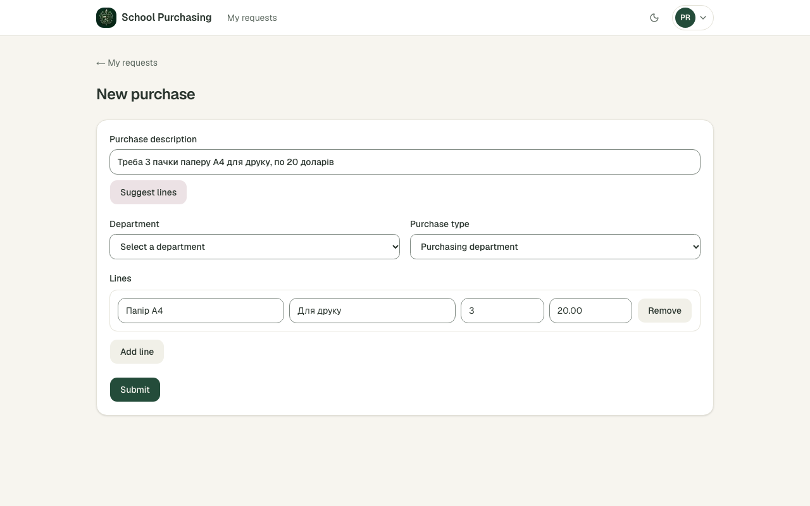
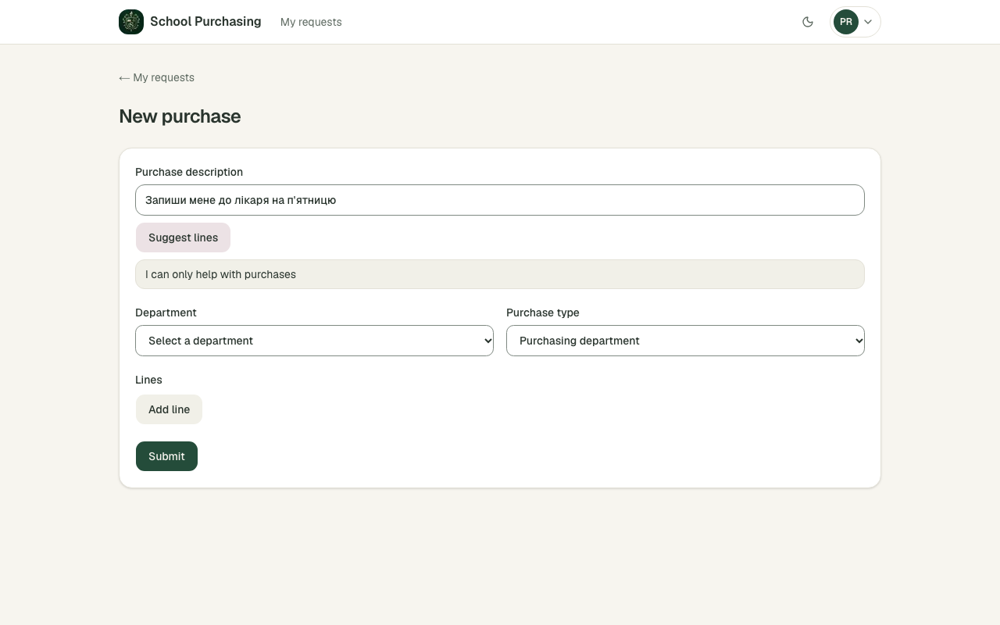

# Звіт UAT — 23.11.2026

- **Застосунок:** https://school-purchasing-lemon.vercel.app (/api/health: коміт `edbdc7e`)
- **Код тестів:** `task/ai-uat` @ `32e3da4`
- **Прогін:** 23.11.2026, 00:05 (Київ), Playwright 24.0 с; AC: 2 — PASS 2, FAIL 0, NEEDS-HUMAN 0
- **Рецензент:** `claude-haiku-5-5`; суперечки → `claude-sonnet-5-5`. Разом за розбір: $0.0787 (ціни API; за підпискою — у межах ліміту плану)
- **Прибирання:** синтетичних uat-*@example.test видалено 0, лишилось 0, їхніх рядків, що лишились: 0
- **Відео й траси:** не в git — `test-results/` локально або артефакт CI; трасу відкриває `npx playwright show-trace <trace.zip>`

| AC | Перевірки | Агент | Підсумок | Чому | Playwright | Розбір |
|---|---|---|---|---|---|---|
| AC-AI-01 | пройшли | Haiku: PASS | **PASS** | R6: перевірки, агент і цитати збігаються | 8.7 с | $0.0031, 9.7 с |
| AC-AI-02 | пройшли | Haiku: NEEDS-HUMAN, Sonnet: PASS | **PASS** | R6: перевірки, агент і цитати збігаються | 4.8 с | $0.0756, 23.6 с |

## AC-AI-01 — PASS

**Тест:** AC-AI-01: працівник 1 вставляє опис «Треба 3 пачки паперу А4 для друку, по 20 доларів» — рядок Папір А4 / Для друку / 3 / 20.00, закупівлю не подано

**Критерій** (requirements/71-ai-proponuie-riadky-zakupivli-za.md):

> AC-AI-01: Дано працівник 1 відкрив форму нової закупівлі. Коли він вставляє опис «Треба 3 пачки паперу А4 для друку, по 20 доларів» і натискає «Запропонувати рядки». Тоді він бачить один рядок: назва «Папір А4», мета «Для друку», кількість 3, ціна 20.00, а закупівлю ще не подано.

**Кроки:** ✔ Дано: працівник 1 відкрив форму нової закупівлі → ✔ Коли: він вставляє опис «Треба 3 пачки паперу А4 для друку, по 20 доларів» і натискає «Запропонувати рядки» → ✔ Тоді: він бачить один рядок: назва «Папір А4», мета «Для друку», кількість 3, ціна 20.00 → ✔ Тоді: закупівлю ще не подано

**Агент (claude-haiku-5-5, PASS):** На обох кадрах видно сторінку «New purchase» з одним рядком у блоці Lines: «Папір А4», «Для друку», 3, 20.00. Кнопка «Submit» на місці, повідомлення «Purchase submitted» не видно, тож закупівля не подана. Написи читаються чітко, обрізання немає.

**Цитати агента, звірені зі сторінкою (aria):**
- «Папір А4» — є на сторінці
- «Для друку» — є на сторінці
- «3» — є на сторінці
- «20.00» — є на сторінці
- «Папір А4» — є на сторінці
- «Для друку» — є на сторінці
- «3» — є на сторінці
- «20.00» — є на сторінці
- «New purchase» — є на сторінці
- «Submit» — є на сторінці

**Правило:** R6: перевірки, агент і цитати збігаються

**Відео:** `test-results/artifacts/ai-suggest-AC-AI-01-праців-82fe2-3-20-00-закупівлю-не-подано-chromium/video-2.webm` · **траса:** `test-results/artifacts/ai-suggest-AC-AI-01-праців-82fe2-3-20-00-закупівлю-не-подано-chromium/trace.zip` (не в git)

**Рішення PM:** ☐ приймаю · ☐ відхилення від вимог (issue «Відхилення від вимог: AC-AI-01 — …») · @login: ____

## AC-AI-02 — PASS

**Тест:** AC-AI-02: працівник 1 вставляє опис «Запиши мене до лікаря на п'ятницю» — «I can only help with purchases», рядків не додано

**Критерій** (requirements/71-ai-proponuie-riadky-zakupivli-za.md):

> AC-AI-02: Дано працівник 1 відкрив форму нової закупівлі. Коли він вставляє опис «Запиши мене до лікаря на п'ятницю» і натискає «Запропонувати рядки». Тоді він бачить повідомлення «Я допомагаю лише із закупівлями», а рядків у формі не додано.

**Кроки:** ✔ Дано: працівник 1 відкрив форму нової закупівлі → ✔ Коли: він вставляє опис «Запиши мене до лікаря на п'ятницю» і натискає «Запропонувати рядки» → ✔ Тоді: він бачить повідомлення «Я допомагаю лише із закупівлями» → ✔ Тоді: рядків у формі не додано

**Агент (claude-sonnet-5-5, PASS):** На обох кадрах під кнопкою «Suggest lines» видно повідомлення «I can only help with purchases». У розділі «Lines» є лише кнопка «Add line», полів Item, Purpose, Quantity, Unit price немає.

Haiku сказав NEEDS-HUMAN, тож розбір повторив Sonnet; рішення агента — за Sonnet.

**Цитати агента, звірені зі сторінкою (aria):**
- «I can only help with purchases» — є на сторінці
- «Lines» — є на сторінці
- «Add line» — є на сторінці

**Правило:** R6: перевірки, агент і цитати збігаються

**Відео:** `test-results/artifacts/ai-suggest-AC-AI-02-праців-665b0-purchases»-рядків-не-додано-chromium/video.webm` · **траса:** `test-results/artifacts/ai-suggest-AC-AI-02-праців-665b0-purchases»-рядків-не-додано-chromium/trace.zip` (не в git)

**Рішення PM:** ☐ приймаю · ☐ відхилення від вимог (issue «Відхилення від вимог: AC-AI-02 — …») · @login: ____

## Як читати підсумок

- **PASS** — автоматичні перевірки пройшли, агент-рецензент погодився з кадром, а кожну його цитату знайдено на сторінці.
- **FAIL** — впала автоматична перевірка. Агент цього не перекриває: невидимі вади (буфер обміну, база) він на кадрі не побачить.
- **NEEDS-HUMAN** — перевірки зелені, але агент не погодився або його цитати немає на сторінці. Часто це слабкий тест або розбіжність між текстом AC і тестом — питання до PM, а не обов'язково вада продукту.

Правила: R1: перевірка впала — FAIL завжди, агент не перекриває; R2: немає вердикту агента або кадру; R3: перевірки пройшли, агент не погоджується — вирішує людина; R4: цитати агента немає на сторінці (aria) — не підтверджено; R5: помилка сторінки або 5xx під час сценарію; R6: перевірки, агент і цитати збігаються.
